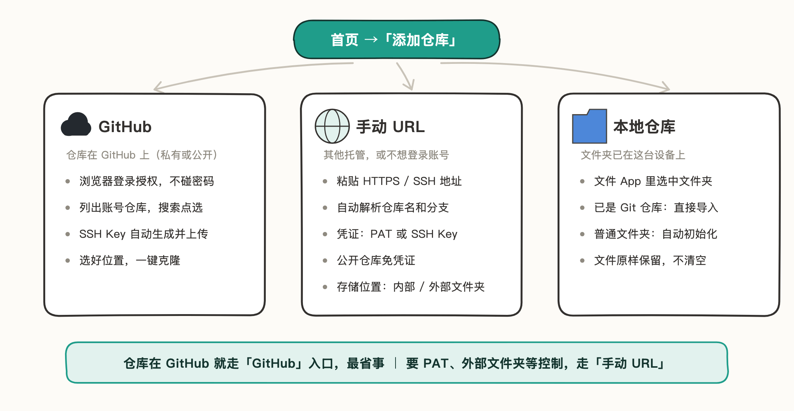
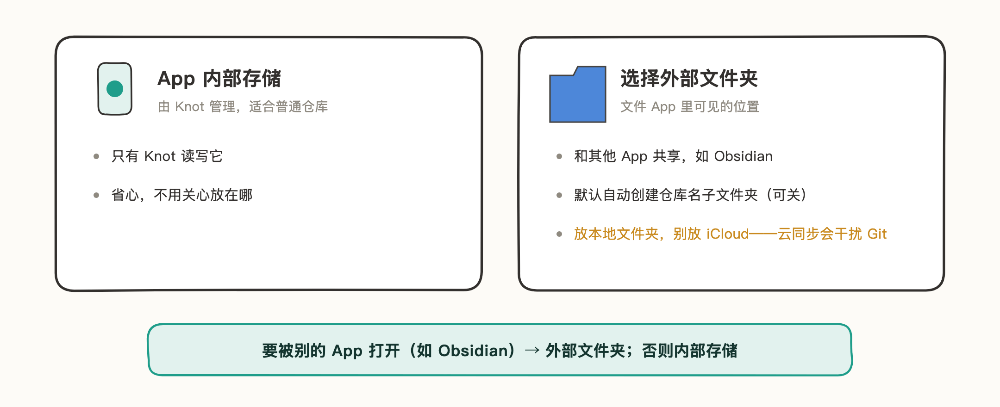
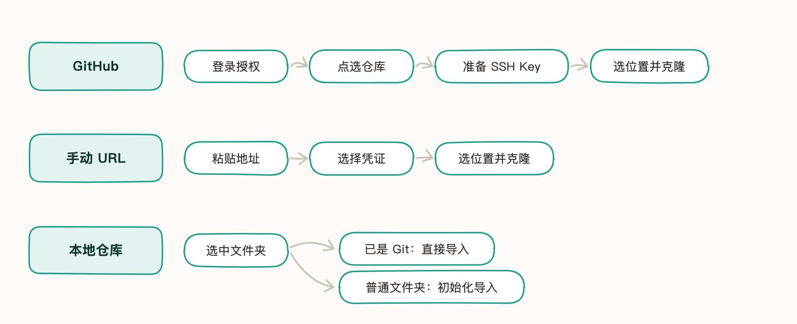

# 添加仓库

把仓库交给 Knot 管理，入口都是首页的「添加仓库」。三个入口对应三种场景：

## 选择存储位置

「GitHub」和「手动 URL」都是把远程仓库克隆到本机，克隆前会经过同一个选择：仓库放在哪。这一步决定除了 Knot，别的 App 能不能读写它。

- **App 内部存储**：由 Knot 管理，只有 Knot 需要读写它——普通仓库选它。
- **选择外部文件夹**：仓库落在文件 App 可见的位置，适合要被其他 App 访问的场景——比如和 Obsidian 共享同一个 Vault。此时默认开启「自动创建仓库名文件夹」——在所选位置下新建一个以仓库名命名的子文件夹；想让仓库内容直接落在所选文件夹里就关掉它（Obsidian 场景要关，见 [Obsidian 同步](07-Obsidian%20同步.md)）。

三个注意点：

- 选中的文件夹非空时，Knot 会列出里面的内容请你确认——确认后清空再克隆，不可撤销；同名文件夹已存在时要换个名字。
- 存储位置选定后不能更改——要换位置，删除仓库后重新添加。
- 外部文件夹放在本地（「我的 iPhone」里），不要放进 iCloud Drive：iCloud 的同步机制可能干扰 Git——仓库的同步交给 Git 就好。

「本地仓库」导入不经过这一步：仓库留在你选中的文件夹里，Knot 原地管理。

## 各入口的添加流程

三个入口的流程跟着界面走就能完成，一张图看清各自的路径：

几个界面上看不出来的点：

- **GitHub**：授权在 GitHub 官方页面完成，Knot 接触不到你的密码；「准备 SSH Key」会生成或复用本机密钥，账号缺公钥时自动上传。原理与界面见 [GitHub 登录](02-GitHub%20登录.md)。
- **手动 URL**：凭证跟着地址走——HTTPS 配 PAT，SSH 配 SSH Key，自动匹配当前域名；公开仓库选「公开仓库」免凭证，没有合适的可以当场添加。
- **本地仓库**：已是 Git 仓库的直接导入，但需已配置远程地址、同一目录不能重复添加；普通文件夹会先初始化为 Git 仓库，文件原样保留、不清空——之后要和远端同步，在托管方建一个**空的**远程仓库（不要勾选自动生成 README），配上地址再推送。

添加完成后仓库出现在首页，日常的提交、推送、拉取见 [Git 操作](05-Git%20操作.md)。
