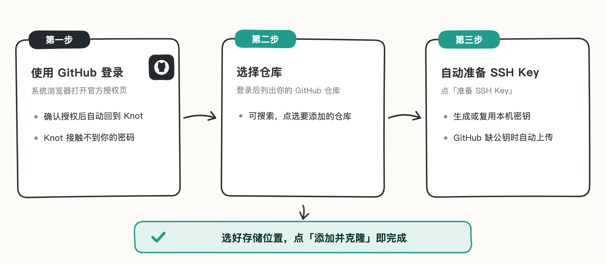

# GitHub 登录

仓库在 GitHub 上时，最省事的方式：登录一次，之后选仓库、准备 SSH Key 都由 Knot 自动完成，不用手动配任何凭证。

> 文中插图为手绘示意图，仅保留关键界面元素，细节以你手机上的实际界面为准。

## 适用场景

- 仓库托管在 GitHub（私有或公开均可）。
- 不想手动配置 PAT 或 SSH Key。

## 登录并添加仓库

1. 在 Knot 里新增仓库，选「GitHub」，点「使用 GitHub 登录」。
2. 系统浏览器打开 GitHub 官方授权页，确认授权后自动回到 Knot。授权在 GitHub 页面上完成，Knot 接触不到你的密码。
3. 在仓库列表里选择要添加的仓库（可搜索）。
4. 点「准备 SSH Key」：Knot 会生成或复用本机的 SSH Key，你的 GitHub 账号缺这个公钥时自动上传。
5. 选好存储位置，点「添加并克隆」。

## 注意事项

- 登录状态过期后重新登录即可，已添加的仓库不受影响。
- 需要换账号时，在添加页点「切换 GitHub 账号」。
- 自动上传的公钥可以在 GitHub → Settings → SSH and GPG keys 里看到和管理。
- 不想登录账号时，也可以改用「手动 URL」+ PAT 或 SSH Key，见本目录另外两篇。
