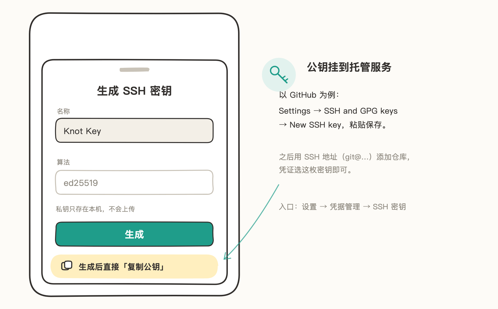
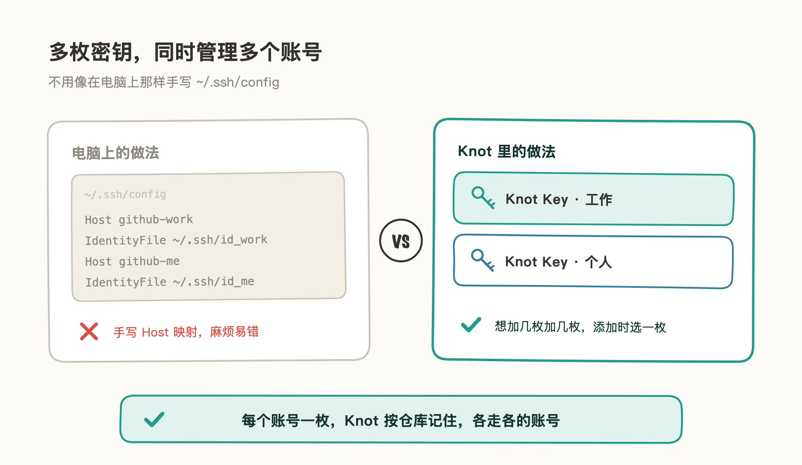
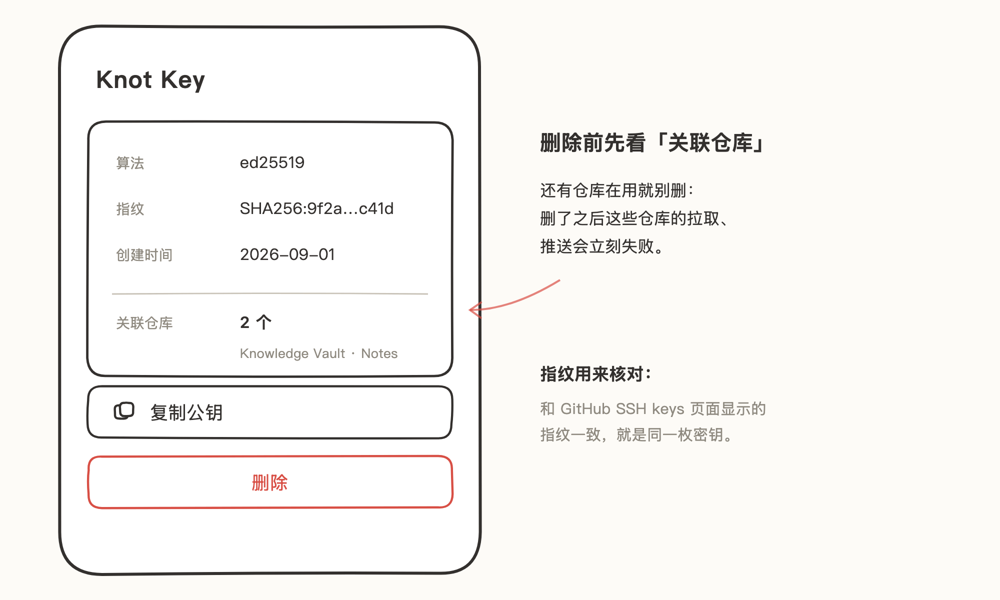

# SSH 密钥

用 SSH 地址（`git@github.com:…`）添加仓库时，用 SSH 密钥验证身份。Knot 可以直接生成密钥对（ed25519），公钥挂到托管服务就能用。

密钥可以加多枚：有多个 GitHub 账号时，每个账号配一枚，各管各的仓库，互不干扰。

## 适用场景
- 给这台设备单独一枚密钥，和电脑上的分开管理。
- 有多个 GitHub 账号（比如工作 + 个人），需要分别管理。

## 生成密钥并挂到托管服务

> 文中插图为手绘示意图，细节以手机上的实际界面为准。

1. 打开 Knot「设置 → 凭据管理 → SSH 密钥」，点「添加 SSH 密钥」。
2. 起个名字（默认「Knot Key」），算法固定为 ed25519，点「生成」。
3. 生成后点「复制公钥」。
4. 把公钥添加到托管服务。以 GitHub 为例：头像 → Settings → SSH and GPG keys → New SSH key，粘贴保存。

之后用 SSH 地址添加仓库，凭证选这枚密钥即可。

## 多枚密钥：同时管理多个账号

电脑上给多个 GitHub 账号配 SSH，通常要手写 `~/.ssh/config` 做 Host 映射，麻烦还容易写错。**Knot 里没这些**：密钥想加几枚加几枚，添加仓库时从列表里选一枚，Knot 按仓库记住，之后拉取、推送各走各的账号。

以工作、个人两个 GitHub 账号为例：

1. 生成两枚密钥，名字起得能分清，比如「Knot Key · 工作」「Knot Key · 个人」。
2. 两枚公钥分别加到两个 GitHub 账号。
3. 添加仓库时选对应账号的密钥；之后随时能在仓库的凭证设置里换。

## 管理已有密钥

「设置 → 凭据管理 → SSH 密钥」列出本机所有密钥，点进任意一枚可查看详情和操作：

- **名称 / 算法**：生成时确定，算法固定 ed25519。
- **指纹**：形如 `SHA256:…`，用来核对托管服务上显示的是不是同一枚密钥。
- **创建时间**。
- **关联仓库**：正在使用这枚密钥的仓库。
- **复制公钥**：要把同一枚密钥挂到另一个托管账号或服务时，从这里复制。
- **删除**：先确认「关联仓库」是空的。还有仓库在用时删了密钥，这些仓库的拉取、推送会立刻失败——先在仓库的凭证设置里换一枚密钥，再回来删。

## 注意事项

- 私钥只存在本机，不会上传；换设备需要重新生成并添加新公钥。
- 一枚公钥在同一个托管账号下只需添加一次，该账号的多个仓库共用。
- 用 GitHub 登录方式添加仓库时不需要手动做这些，Knot 会自动准备并上传公钥，见 [GitHub 登录](02-GitHub%20登录.md)。
- 删除只删本机密钥；托管服务上已添加的对应公钥，需要时去那边单独删。
- 怀疑私钥泄露时：先在托管服务删掉对应公钥，再在 Knot 删除这枚密钥并生成新的。
