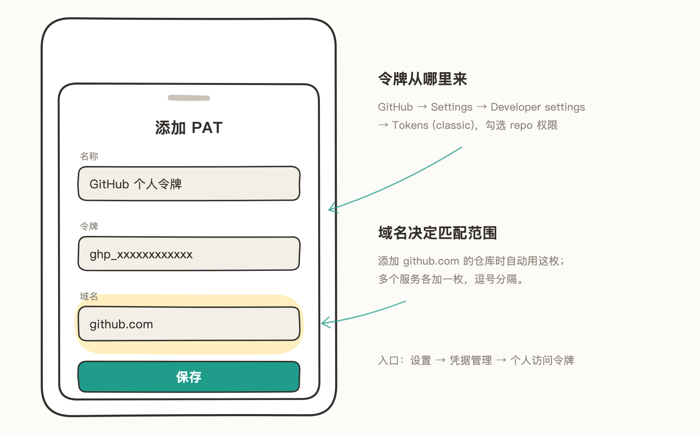

# 个人访问令牌（PAT）

用 HTTPS 地址添加私有仓库时，托管服务用令牌代替密码验证身份。Knot 按域名管理令牌：哪个域名的仓库，用哪枚令牌。

> 文中插图为手绘示意图，仅保留关键界面元素，细节以你手机上的实际界面为准。

## 适用场景

- 想细粒度管理权限：令牌可以只放行指定仓库、设有效期、限定只读——比登录账号的控制更精细，适合对权限有要求的高阶用户。
- 用 HTTPS 地址添加私有仓库，且不想走 GitHub 登录或 SSH。

公开仓库不需要令牌：HTTPS 地址添加时，凭证选「公开仓库」就能直接克隆。

## 第一步：在托管服务生成令牌

以 GitHub 为例：

1. 打开 github.com，点头像 → Settings → Developer settings → Personal access tokens → Tokens (classic)。
2. 点「Generate new token (classic)」，勾选 `repo` 权限（读写仓库内容需要它）。
3. 生成后立刻复制令牌——页面关掉后无法再查看完整内容。

要细粒度控制时，改用「Fine-grained personal access tokens」生成：可以只放行指定仓库、限定只读、设较短的有效期。

## 第二步：在 Knot 添加令牌

1. 打开 Knot「设置 → 凭据管理 → 个人访问令牌」，点「添加 PAT」。
2. 名称随意取（比如「GitHub 个人令牌」）；「令牌」粘贴上一步复制的 `ghp_…`；「域名」填 `github.com`。
3. 保存。

域名决定匹配范围：之后添加 `github.com` 的仓库时，Knot 自动匹配这枚令牌。用多个服务就各加一枚（比如再来一枚域名 `gitlab.com` 的）。

## 注意事项

- 令牌等于密码，泄露后立刻去托管服务 Revoke。
- 令牌过期或被 Revoke 后，在凭据管理里编辑这枚 PAT、换上新令牌即可，已添加的仓库不用动。
- 多个域名用英文逗号分隔。
- SSH 地址（`git@…`）的仓库用不到 PAT，走 SSH 密钥，见 [SSH 密钥](03-SSH%20密钥.md)。
