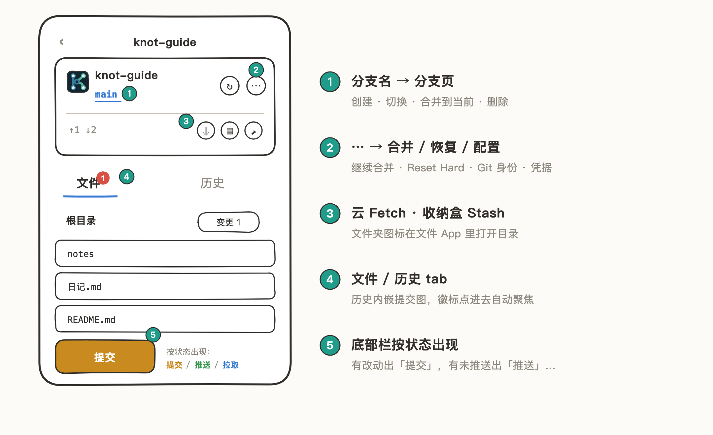
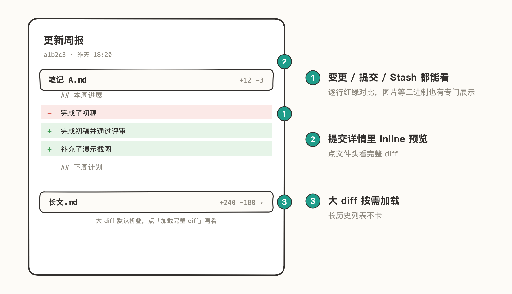
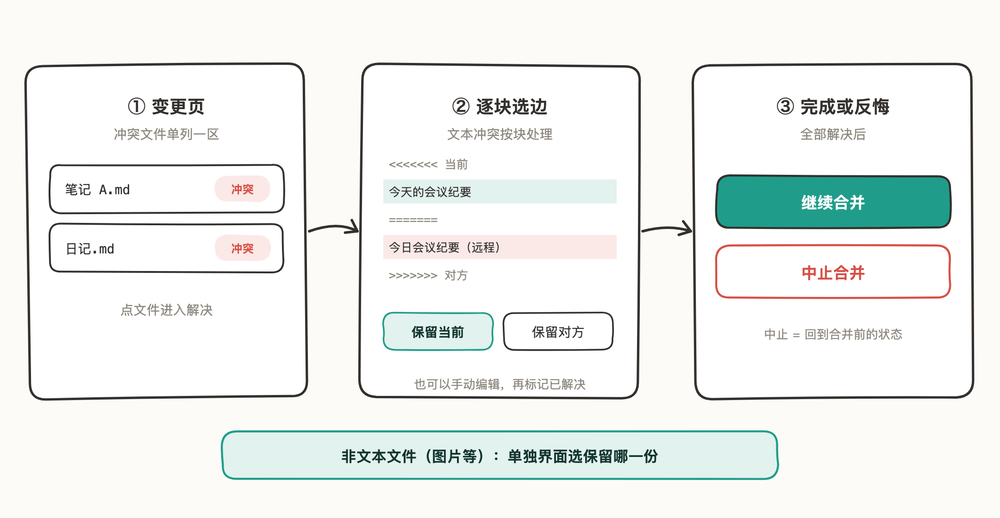
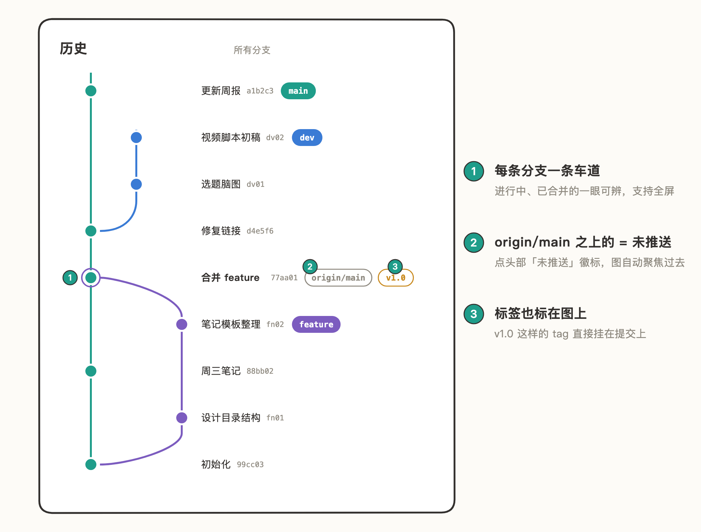
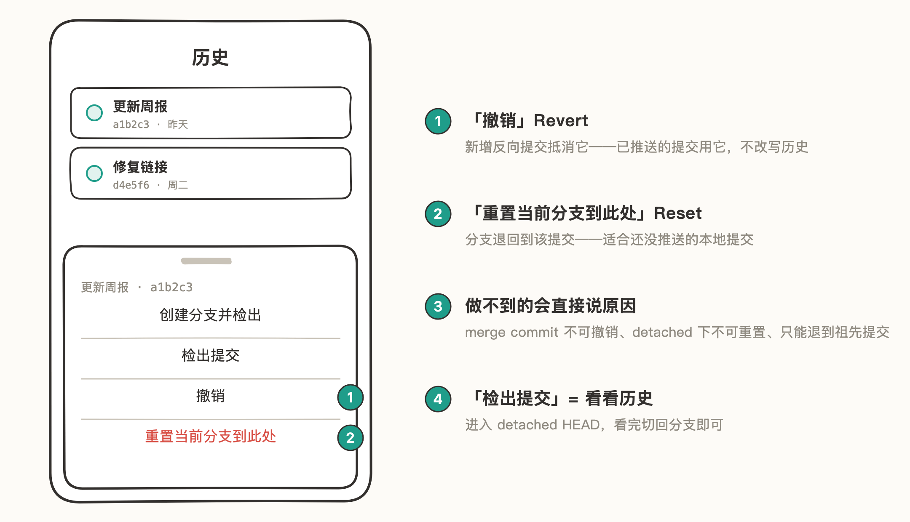

# Git 操作

Knot 支持完整的 Git 操作：提交、推送、拉取、Fetch、分支、Stash、合并、Reset、Revert，全部在仓库详情页里完成。

想直接试试？[动手体验](08-动手体验.md) 准备了暂存、提交、Stash 和冲突解决练习。

| 操作 | 入口 |
| --- | --- |
| 提交 / 推送 / 拉取 | 底部栏（有改动出「提交」，有未推送出「推送」，有未拉取出「拉取」） |
| Fetch | 头部卡片的云图标 |
| 分支 | 点头部的分支名（如 main） |
| Stash | 头部卡片的收纳盒图标 |
| Reset / Revert | 「历史」tab 里点某个提交 |
| 合并 / 恢复 / 配置 | 头部卡片的「⋯」 |

底部栏按状态只显示当前能做的操作，不会被按不了的按钮干扰。常规操作就这些，下面几件事是 Knot 做得比较细的地方。

## 看得见的 Diff

变更、提交历史、Stash 里的文件都能看 diff，逐行红绿对比：

- 提交详情里每个文件直接 inline 预览，点文件头看完整 diff。
- 大 diff 默认折叠，点「加载完整 diff」再看，长历史不卡。
- 图片等二进制文件也有专门的展示，不是一行 "Binary files differ"。

## 冲突解决：手机上也能处理 merge

Pull 或合并产生冲突时不用切到电脑：

1. 冲突文件在「变更」页单列一区，点文件进入解决。
2. 文本冲突逐块处理：选「保留当前」或「保留对方」，也可以手动编辑，完事标记已解决；非文本文件（图片等）单独选保留哪一份。
3. 全部解决后「继续合并」完成；后悔了「中止合并」，回到合并前的状态。

## 提交图：分支关系一目了然

「历史」tab 内嵌提交图，所有分支的走向、合并点直接看，支持全屏。点头部卡片的「未推送 / 未拉取」徽标，图会自动聚焦到对应的提交。

## 安全的 Reset / Revert

在「历史」里点任一提交，弹出的操作菜单：创建分支并检出 / 检出提交 / 撤销（Revert）/ 重置当前分支到此处（Reset）。

- 做不到的操作会直接说明原因：Reset 前自动分析，只能退到当前分支的祖先提交；merge commit 不能撤销；detached HEAD 下不能 Reset。
- 已推送的提交用「撤销」——新增反向提交，不改写历史；还没推送的才用「重置」。

## 更多顺手的细节

- **带 Stash 切分支**：工作区有改动也能切分支，改动暂存起来不丢。
- **首次推送新分支**：询问是否设为上游，之后 Push/Pull 一键完成。
- **提交前检查 Git 身份**：没配置会引导去设置，不会提交出匿名 commit。
- **恢复区**（「⋯」面板）：Reset Hard 到 HEAD（放弃全部未提交改动）、清理卡住的 index.lock——不用删仓库重来。
- **Obsidian 仓库识别**：检测到 Obsidian 仓库自动提示配置 .gitignore，见 [Obsidian 同步](07-Obsidian%20同步.md)。
