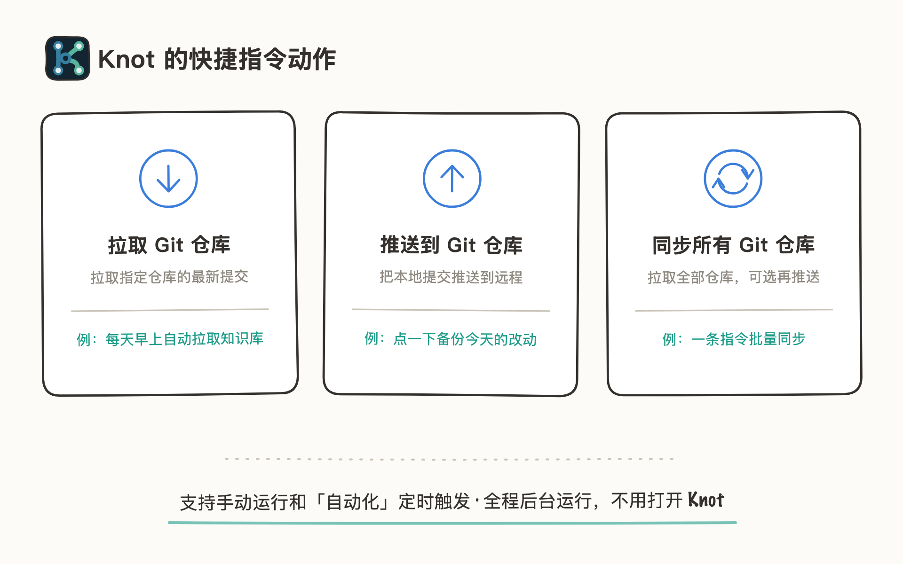
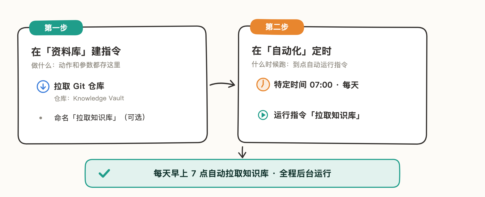
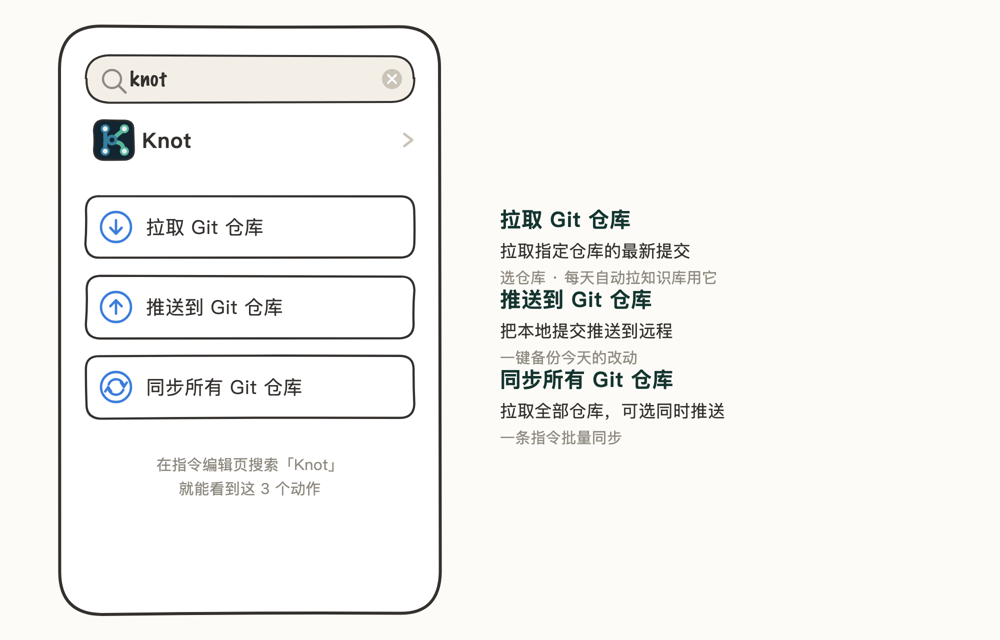
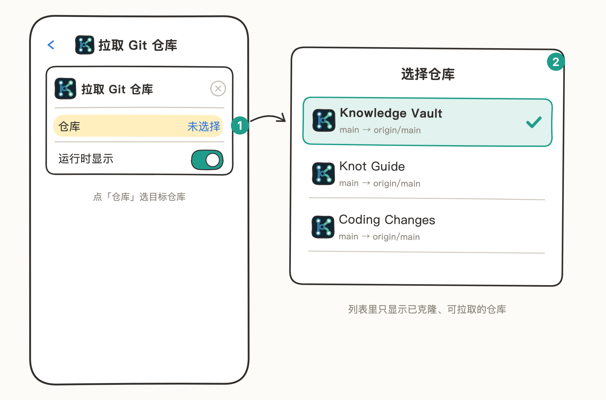
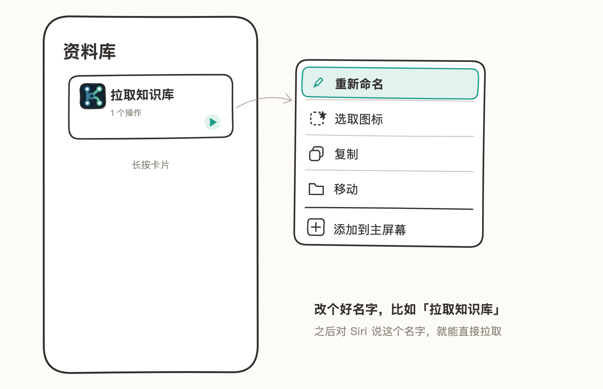
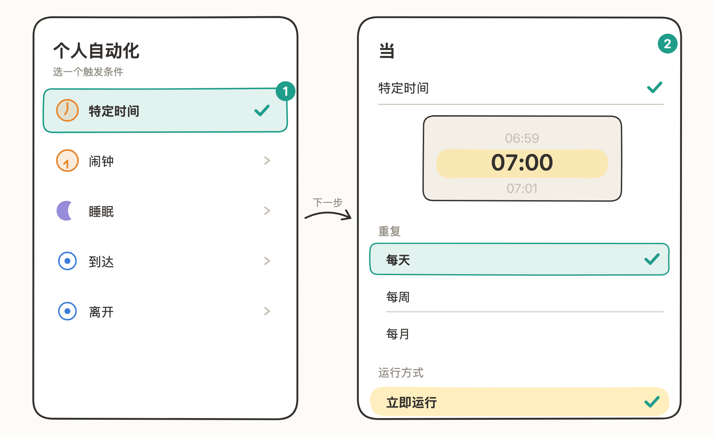
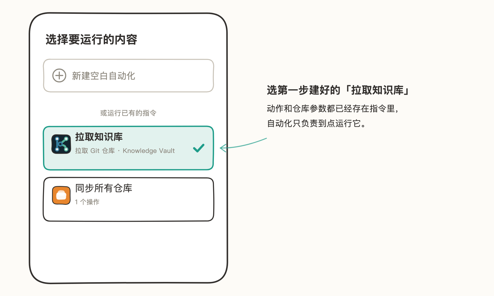
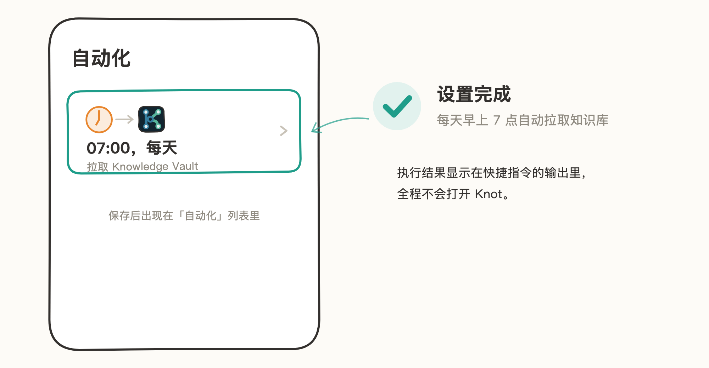

# Shortcuts（快捷指令）

Knot 为 iOS 系统「快捷指令」App 提供 3 个动作：拉取、推送、同步所有仓库。可以定时自动执行、或点一下就完成同步，全程在后台运行，不用打开 Knot。

> 文中插图为手绘示意图，仅保留关键界面元素，细节以你手机上的实际界面为准。

## 适用场景

- **每天自动拉取**：每天早上自动拉取知识库，打开 Obsidian 时就是最新内容。
- **一键备份**：点一下「推送」，把今天的改动传到远程。
- **批量同步**：一条指令拉取所有仓库，可选同时推送。

## 建一个「每天早上 7 点自动拉取知识库」的自动化

以拉取 Knowledge Vault 仓库为例。整个配置分两步：先在「资料库」把指令建好，再到「自动化」里让它定时跑。

### 第一步：在「资料库」建好指令

动作和仓库参数都存在指令里，建好之后它本身就是一个可独立运行的指令。

1. 打开「快捷指令」App，底部切到「资料库」（你创建的指令都存在这里），点右上角「+」。
2. 在搜索框输入「Knot」，选择「拉取 Git 仓库」。

   Knot 一共提供 3 个动作：拉取、推送、同步所有，这里用「拉取 Git 仓库」。

   

3. 点动作卡片里的「仓库」参数，在列表中选择 Knowledge Vault。

   

4. 点「完成」，指令出现在资料库列表里。点卡片上的 ▶ 可以随时手动拉取。

### 可选：给指令起个好名字

长按指令卡片，选「重新命名」，改成比如「拉取知识库」。多个仓库时，不同的名字方便区分；之后对 Siri 说这个名字，也能直接触发拉取。

### 第二步：在「自动化」里让它定时跑

1. 底部切到「自动化」，点「新建自动化」（已有自动化时点右上角「+」）。
2. 选触发条件。这里选「特定时间」（也可以是打开某个 App 时等）：时间设为 07:00、重复选「每天」；运行方式选「立即运行」，这样每天到点直接执行，不会弹确认。

   

3. 点「下一步」，在「选择要运行的内容」里选第一步建好的「拉取知识库」。

   

4. 保存后，它会出现在「自动化」列表里：07:00，每天，拉取 Knowledge Vault。之后每天早上 7 点自动拉取，全程不会打开 Knot。

   

## 注意事项

- 三个动作都在后台执行，执行结果显示在快捷指令的输出里，不会打开 Knot。
- 快捷指令同步受 Knot 内购额度限制；未解锁时动作会提示需要先在 Knot 中解锁。
- 刚添加、还没完成克隆的仓库不会出现在「拉取 Git 仓库」的选择列表里：先在 Knot 里完成一次克隆。
