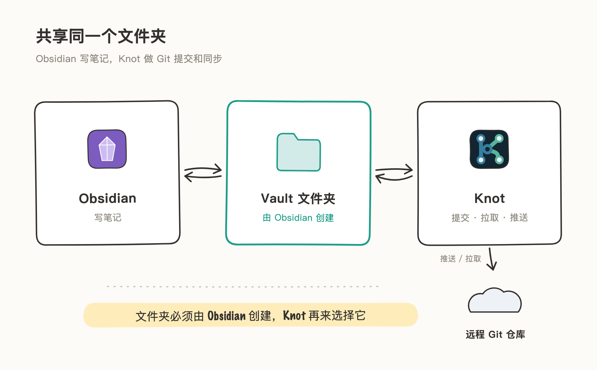
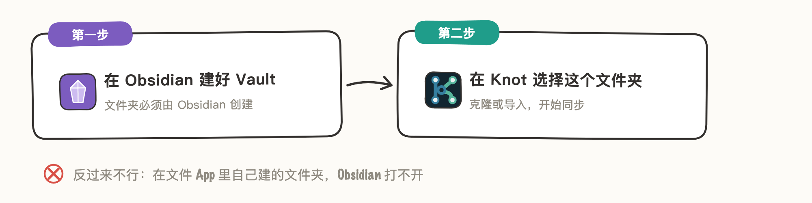
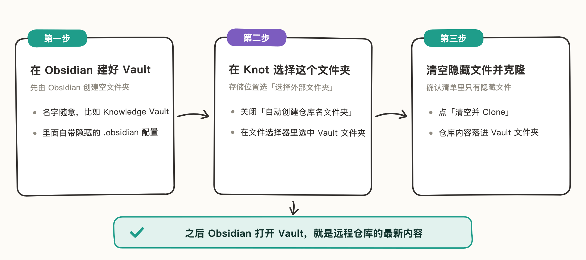
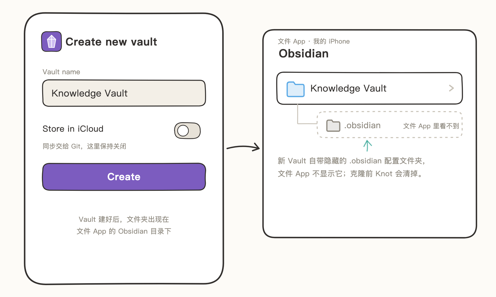
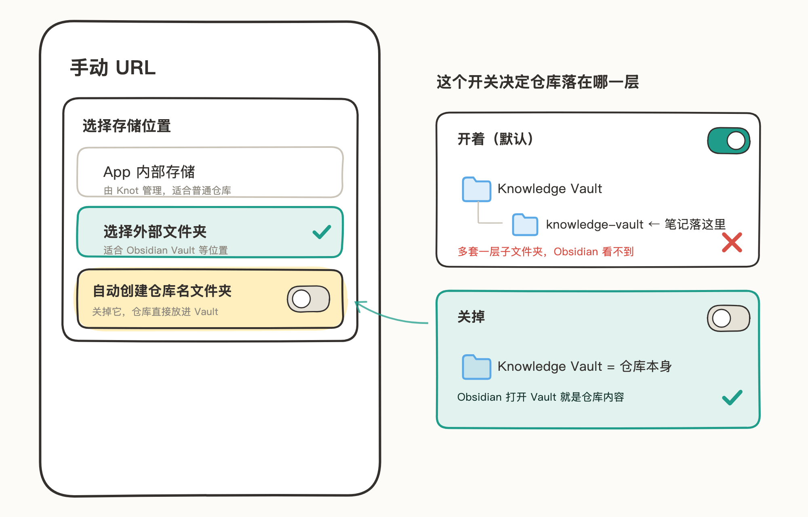
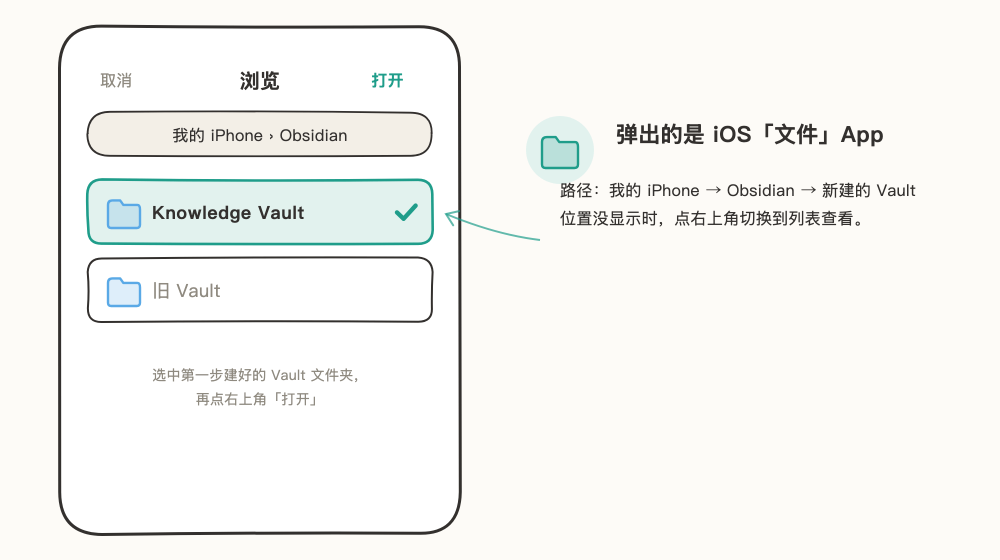
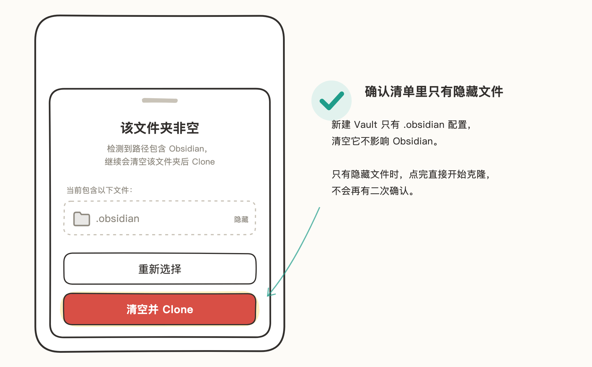
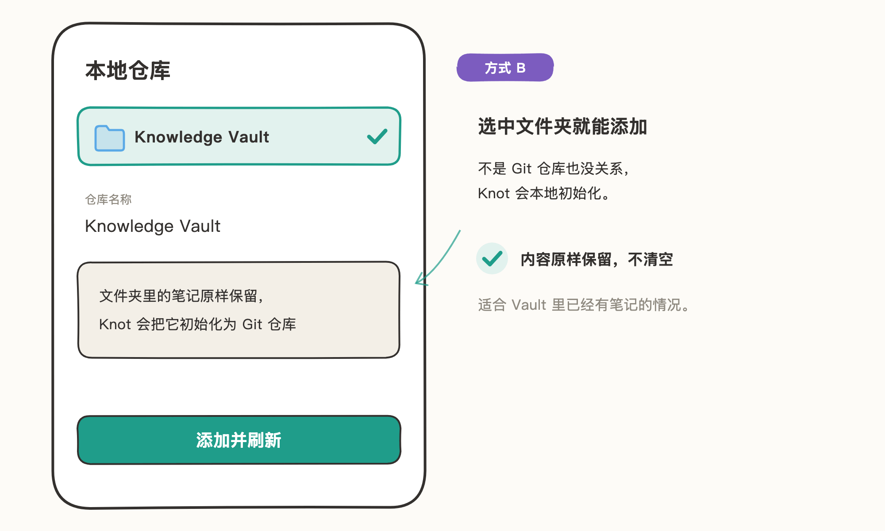

# Obsidian 同步

Knot 和 Obsidian 通过共享同一个文件夹协作：Obsidian 在这个文件夹里写笔记，Knot 负责这个文件夹的 Git 提交、拉取和推送。

Obsidian 只认自己创建的文件夹，所以顺序是固定的：先在 Obsidian 里建好 Vault，再到 Knot 里选择这个文件夹。在文件 App 里自己建的文件夹，Obsidian 打不开。

> 文中插图为手绘示意图，仅保留关键界面元素，细节以你手机上的实际界面为准。

## 适用场景

- **拉取已有知识库到新设备**：远程已有知识仓库，想在 iPhone / iPad 的 Obsidian 里继续写。
- **已有 Vault 接入 Git 同步**：Vault 里已经有笔记，交给 Knot 做提交和同步。

## 两种接入方式

- **方式 A：新建 Vault 并克隆（推荐）** —— 远程已有知识仓库，设备上全新开始：Obsidian 建一个空 Vault，Knot 清掉里面的隐藏配置文件，把仓库克隆进去。
- **方式 B：导入已有 Vault** —— Vault 里已有笔记、不能清空：Knot 把它初始化为 Git 仓库并导入，内容原样保留。

## 方式 A：新建 Vault 并克隆（推荐）

以把远程的 Knowledge Vault 仓库拉到这台设备为例。整个配置分三步：

### 第一步：在 Obsidian 建好 Vault

1. 打开 Obsidian，创建一个新 Vault，名字随意（比如 Knowledge Vault）。「Store in iCloud」保持关闭——同步交给 Git，不要让 iCloud 同时管同一份文件。
2. 创建后，文件夹出现在文件 App 的「我的 iPhone → Obsidian」目录下。里面已经有一个隐藏的 `.obsidian` 配置文件夹——文件 App 默认不显示它，但它是存在的；克隆前 Knot 会清掉它。

### 第二步：在 Knot 新增仓库，选择这个文件夹

在 Knot 里新增仓库。流程走到「选择存储位置」时，选「选择外部文件夹」，然后关闭「自动创建仓库名文件夹」（默认开启）。

- 开着：Knot 会在你选的文件夹里再新建一个以仓库名命名的子文件夹，笔记落在子文件夹里，Obsidian 看不到。
- 关掉：仓库直接放进你选的 Vault 文件夹。

接着弹出的是 iOS 的「文件」App：进入「我的 iPhone」→ Obsidian（位置没显示时，点右上角切换到列表查看），选中第一步建好的 Vault 文件夹。

### 第三步：清空隐藏文件并克隆

选完文件夹，Knot 检测到它非空（里面有 `.obsidian`），弹出内容清单。确认清单里只有 `.obsidian` 这类隐藏文件，点「清空并 Clone」。只有隐藏文件的 Obsidian 文件夹不会再弹二次确认，直接清空并开始克隆。

克隆完成后回 Obsidian 打开这个 Vault，内容就是远程仓库的最新状态。之后写笔记、提交、推送，两个 App 操作的是同一个文件夹。

## 方式 B：导入已有 Vault

Vault 里已有笔记、不能清空时用这种方式。选中文件夹后，Knot 会把它初始化为 Git 仓库并导入，内容原样保留，不清空。

1. 在 Knot 里新增仓库，选「本地仓库」。
2. 在弹出的「文件」App 里选中 Vault 文件夹（路径：「我的 iPhone → Obsidian」）。
3. 确认仓库名称，点「添加并刷新」。

## 注意事项

- 「自动创建仓库名文件夹」默认开启；和 Obsidian 共享文件夹时记得关闭，否则仓库会落在 Vault 里面一层子文件夹，Obsidian 看不到。
- 「清空并 Clone」会删除文件夹里的所有内容。远程仓库自带 `.obsidian` 配置时，克隆后会恢复；不带的话，Obsidian 下次打开 Vault 时会重建默认配置。
- 文件夹里除了隐藏文件还有别的内容时，「清空并 Clone」会再弹一次确认；不确定里面有什么的话，先回文件 App 看清楚再点。
- 已经是 Git 仓库的文件夹不能作为克隆目标（Knot 会提示选择空文件夹），改用「本地仓库」导入。
- 仓库的存储位置选定后不能更改；要换位置，删除仓库后重新添加。
